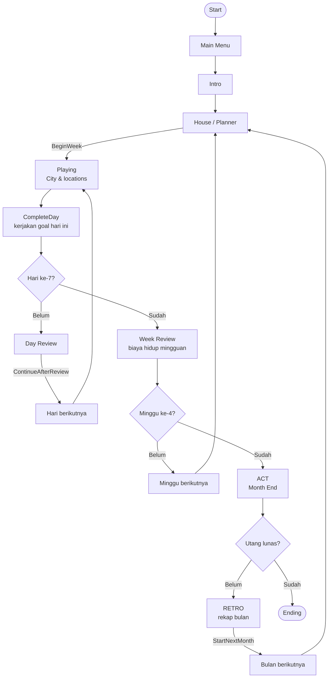
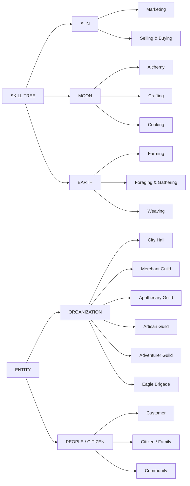

# Bloom Lunas — Core Loop

Dokumen ini pasangan dari `Assets/Script/CoreLoop.cs`.
Script tersebut **tidak membuat UI, tidak membuat GameObject, dan tidak memuat scene
secara otomatis** kecuali opsi `Load Scenes` dinyalakan.

Sistem Buku Planner yang mengisi tujuh hari dan delapan halamannya dijelaskan
terpisah di [`Docs/PlannerBook.md`](PlannerBook.md).

---

## 1. Diagram putaran utama



### Arti fase

| Fase | Dipakai untuk |
|---|---|
| `MainMenu` | Menu awal, belum ada data permainan. |
| `Planning` | Di House/planner, menyusun tujuan 7 hari. |
| `Playing` | Di CityOverWorld, menjalankan hari berjalan. |
| `DayReview` | Panel Check setelah satu hari selesai. |
| `WeekReview` | Rekap minggu dan pemotongan biaya hidup. |
| `MonthEnd` | Layar **Act**: bayar utilitas dan utang. |
| `Retro` | Layar **Retro**: rekap satu bulan. |
| `Ending` | Utang sudah lunas. |

---

## 2. Diagram sistem



### Kegiatan tiap organisasi

| Organisasi | Kegiatan |
|---|---|
| **City Hall** | Permit, licensing service, city request (NPC + player), guild skill |
| **Merchant Guild** | Buy & sell, wholesale buy & sell, merchant network (NPC + player), quest board |
| **Apothecary Guild** | Product certification, recipe research, materials buy & sell, moon & earth skill |
| **Artisan Guild** | Uproot and fix stuff, machinery/tools/weapons (buy), product sell, moon skill |
| **Adventurer Guild** | Rumour & information, product sell, adventuring activity (player + NPC), earth skill |
| **Eagle Brigade** | Product sell, security activity (player + NPC), guild skill |

Tiga cabang skill di atas adalah jalur progression. Organisasi dan people adalah
tempat kegiatan itu terjadi; CoreLoop hanya mengatur **kapan** kegiatan berjalan,
bukan isi setiap kegiatan.

---

## 3. API CoreLoop yang dipakai tombol

| Method | Kapan dipanggil |
|---|---|
| `StartNewGame()` | Tombol New Game / mulai dari Main Menu. |
| `BeginWeek()` | Tombol Start Week di planner. |
| `CompleteDay()` | Kasur atau tombol End Day. |
| `ContinueAfterReview()` | Tombol Continue di panel Check. |
| `ContinueAfterWeek()` | Bisa dipanggil langsung dari tombol Week Review. |
| `SettleMonth(int debtPayment)` | Tombol Pay/Close Month di Act. |
| `SettleMonth(int debtPayment, int utilityPayment)` | Versi Act jika pembayaran utilitas diatur terpisah. |
| `StartNextMonth()` | Tombol Next/New Game di Retro. |
| `ReturnToMenu()` | Tombol Menu. |
| `AddGold(int)` / `SpendGold(int)` | Saat menjual/membeli. |
| `RecordSale(int amount, int units)` | Saat satu produk terjual. |
| `PayDebt(int)` | Pembayaran utang di luar Act. |
| `AddDebt(int)` | Denda, bunga, atau biaya tak terduga. |

Properti penting untuk UI: `Phase`, `Month`, `Week`, `DayIndex`, `DayName`,
`Gold`, `Debt`, `MonthGoldEarned`, `MonthGoldSpent`, `MonthDebtPaid`,
`MonthProductsSold`, dan `LastMonthReport`.

Event:

```csharp
CoreLoop.Instance.StateChanged += RefreshHud;
CoreLoop.Instance.MonthClosed += ShowRetroReport;
```

---

## 4. Tutorial memasang di Unity

### Langkah 1 — masukkan script

1. Buat folder `Assets/Script` jika belum ada.
2. Masukkan `CoreLoop.cs` ke folder tersebut.
3. Tunggu Unity selesai compile. Jangan menekan Play dulu.

Script ini tidak memiliki `[ExecuteInEditMode]`, tidak memakai `new GameObject`,
dan tidak membuat Canvas. Saat Play, tidak ada UI yang muncul dari script ini.

### Langkah 2 — buat satu objek pengatur

1. Buka scene `MainMenu`.
2. Klik kanan Hierarchy → **Create Empty**.
3. Beri nama `GameSystems`.
4. Add Component → ketik `CoreLoop`.
5. Biarkan **Persist Between Scenes** tercentang.

Cukup satu `CoreLoop` untuk seluruh game. Jangan menaruhnya di setiap scene;
objek pertama akan dibawa dengan `DontDestroyOnLoad`.

### Langkah 3 — atur nilai awal

Di Inspector `CoreLoop`:

- `Weeks Per Month` = `4`
- `Starting Gold` = `240`
- `Starting Debt` = `3000`
- `Weekly Living Cost` = `40`
- `Monthly Utilities` = `120`
- `Minimum Debt Payment` = `450`

`Load Scenes` biarkan **mati** dulu. Dengan begitu tidak ada perpindahan scene
otomatis; kamu bisa menguji tombol satu per satu. Nyalakan nanti jika sudah yakin.

### Langkah 4 — daftarkan scene

Masuk **File → Build Profiles / Build Settings**, lalu tambahkan:

1. `MainMenu`
2. `MulaiGame`
3. `CityOverWorld`

Hanya perlu jika `Load Scenes` dinyalakan. Kalau `Load Scenes` mati, tombol
`Start.ChangeScene` yang sudah ada tetap bisa memanggil scene secara manual.

### Langkah 5 — hubungkan tombol

Di panel Button → `OnClick ()`:

| Tombol | Objek | Method |
|---|---|---|
| New Game | `GameSystems` | `CoreLoop.StartNewGame` |
| Start Week | `GameSystems` | `CoreLoop.BeginWeek` |
| End Day / Bed | `GameSystems` | `CoreLoop.CompleteDay` |
| Continue (Check) | `GameSystems` | `CoreLoop.ContinueAfterReview` |
| Pay / Close Month | `GameSystems` | `CoreLoop.SettleMonth` |
| Next Month (Retro) | `GameSystems` | `CoreLoop.StartNextMonth` |
| Menu | `GameSystems` | `CoreLoop.ReturnToMenu` |

Untuk `SettleMonth`, isi parameter dengan nilai stepper pembayaran utang.
Kalau memakai tombol dengan nilai tetap, isi `450` terlebih dahulu; nanti ganti
dengan nilai dari stepper Act.

### Langkah 6 — panel Act dan Retro

Karena CoreLoop tidak membuat UI:

1. Buat Canvas/panel Act dan Retro secara manual.
2. Saat `CoreLoop.Instance.Phase == GamePhase.MonthEnd`, tampilkan panel Act.
3. Saat tombol Pay ditekan, panggil `SettleMonth(...)`.
4. Setelah itu phase berubah menjadi `Retro` dan event `MonthClosed` membawa
   `MonthReport` untuk ditampilkan.
5. Tombol Next Month memanggil `StartNextMonth()`.
6. Jika utang lunas, phase berubah menjadi `Ending`; tampilkan layar akhir.

Contoh listener sederhana (buat script UI terpisah, bukan di dalam CoreLoop):

```csharp
using TMPro;
using UnityEngine;

public class CoreLoopHud : MonoBehaviour
{
    [SerializeField] private TMP_Text statusText;

    private void OnEnable()
    {
        if (CoreLoop.Instance == null) return;
        CoreLoop.Instance.StateChanged += Refresh;
        CoreLoop.Instance.MonthClosed += ShowMonthReport;
        Refresh();
    }

    private void OnDisable()
    {
        if (CoreLoop.Instance == null) return;
        CoreLoop.Instance.StateChanged -= Refresh;
        CoreLoop.Instance.MonthClosed -= ShowMonthReport;
    }

    private void Refresh()
    {
        CoreLoop loop = CoreLoop.Instance;
        if (loop == null || statusText == null) return;

        statusText.text =
            loop.Phase + "  |  Month " + loop.Month +
            "  |  Week " + loop.Week +
            "  |  " + loop.DayName +
            "\nGold " + loop.Gold + " G  |  Debt " + loop.Debt + " G";
    }

    private void ShowMonthReport(MonthReport report)
    {
        Debug.Log(report.summary);
    }
}
```

### Langkah 7 — urutan pengujian

1. Tekan Play di `MainMenu`.
2. Pastikan `GameSystems` hanya satu di Hierarchy.
3. Klik New Game → phase menjadi `Planning`.
4. Klik Start Week → phase menjadi `Playing`, hari `Monday`.
5. Klik End Day → `DayReview`; Continue → hari berikutnya.
6. Ulangi sampai `Sunday` → `WeekReview`.
7. Setelah minggu ke-4 → `MonthEnd` (Act).
8. Bayar utang → `Retro` atau `Ending`.
9. Dari Retro klik Next Month → kembali ke `Planning`.

Kalau kamu membuka `CityOverWorld` langsung dari Editor tanpa melewati
`MainMenu`, `CoreLoop.Instance` akan `null`. Itu normal karena `GameSystems`
belum ada di scene tersebut. Mulailah dari `MainMenu`, atau tambahkan
`GameSystems` sebagai bootstrap di scene yang sedang kamu uji.

---

## 5. Catatan penting

- Jangan mengaktifkan `CoreLoop` bersamaan dengan loop lama seperti
  `GameManager`, `DailyScheduleRunner`, atau `GameOS` yang membuat UI sendiri.
  Pilih satu pengatur waktu; kalau tidak, hari dan bulan bisa bertambah dua kali.
- CoreLoop tidak pernah memanggil `FindObjectOfType`, `Instantiate`, atau
  `AddComponent` untuk UI.
- Semua tombol dan panel harus kamu taruh sendiri di scene.
- `Load Scenes` sengaja default mati agar tidak ada perpindahan scene yang
  mengejutkan saat pertama kali mencoba.
- Biaya hidup dipotong di akhir minggu; utilitas dan utang dibayar di Act.
- Kekurangan biaya hidup atau utilitas otomatis masuk ke utang.
- `StartNewGame()` mereset bulan, minggu, gold, dan utang ke nilai awal.
- `StartNextMonth()` membawa sisa utang dan gold ke bulan berikutnya.

## 6. Integrasi dengan Planner

`CoreLoop` sekarang memancarkan dua event tambahan untuk planner:

```csharp
CoreLoop.Instance.NewGameStarted += ResetPlanner;
CoreLoop.Instance.DayCompleted += FinishDayGoal;
```

- `NewGameStarted` dipanggil setelah New Game mereset kalender dan ekonomi.
- `DayCompleted` membawa index hari 0-6 sebelum fase berubah ke `DayReview`.

`PlannerBook` memakai event tersebut untuk mereset rencana dan menandai goal yang
belum selesai. Detail pemasangan ada di [`Docs/PlannerBook.md`](PlannerBook.md).
Interaksi gedung dan karakter di kota ada di [`Docs/CityOverWorld.md`](CityOverWorld.md).
